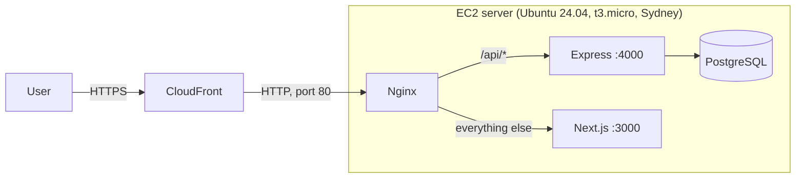

# Deploying the DSA Sheet app (AWS)

One small EC2 server runs everything. CloudFront in front gives a free HTTPS address.



**Why CloudFront is needed:** in production the login cookies are `secure`, so browsers only keep them over
HTTPS. A bare EC2 address is plain HTTP, so login would silently fail. CloudFront gives
`https://dxxxxxxxxxxxx.cloudfront.net` for free, no domain needed.

**Cost** (Sydney, approx.): t3.micro ≈ $10/month + 20 GB disk ≈ $2 + public IPv4 address ≈ $3.6 while running.
Stopped: only disk + IP ≈ $6/month. On the AWS free plan this comes out of your credits. CloudFront for a demo
is within its free allowance. **Stop the server when you're not using it** (EC2 → Instances → Stop).
CPU credits are set to **standard**, so heavy use only slows the server down; it never adds charges.

**Region:** new free-plan accounts may be limited to one region (ours only allows **ap-southeast-2, Sydney**:
other regions return "explicit deny in a service control policy"). Use the region your account allows.

| File                   | What it is                                                      |
| ---------------------- | --------------------------------------------------------------- |
| `setup-server.sh`      | One-time server setup: packages, database, `.env`, build, start |
| `update.sh`            | Deploy the latest code from GitHub                              |
| `nginx.conf`           | `/api/*` → Express, everything else → Next.js                   |
| `ecosystem.config.cjs` | PM2: keeps both apps running and restarts them after a reboot   |

## 1. Security group (the server's firewall)

EC2 → Security Groups → Create, in your region (here **ap-southeast-2, Sydney**), name `dsa-sheet`:

| Type | Port | Source                                                          | Why                               |
| ---- | ---- | --------------------------------------------------------------- | --------------------------------- |
| SSH  | 22   | **My IP**                                                       | Only you can log in               |
| HTTP | 80   | Prefix list **`com.amazonaws.global.cloudfront.origin-facing`** | Only CloudFront can reach the app |

Port 80 must accept **only CloudFront**. The backend trusts the visitor IP that CloudFront adds
(`TRUST_PROXY_HOPS=2`); if anyone could reach port 80 directly, they could fake that IP and dodge the login rate limit.

## 2. The server

EC2 → Launch instance:

- Name `dsa-sheet`, image **Ubuntu Server 24.04 LTS**, type **t3.micro** (free-tier eligible; `setup-server.sh` adds 2 GB swap). Credit specification: **Standard**
- Key pair: create a new one `dsa-sheet` (download the `.pem`, keep it safe: `chmod 400 dsa-sheet.pem`)
- Security group: `dsa-sheet` from step 1
- Storage: **20 GB** gp3

Then: Elastic IPs → Allocate → Associate with the instance, so the address doesn't change after a stop/start.
(Every public IPv4 address costs ≈ $3.6/month, even this one while the server is stopped; it saves updating CloudFront after each restart.)

## 3. Set up the app on the server

```bash
ssh -i dsa-sheet.pem ubuntu@<ELASTIC_IP>
curl -fsSL https://raw.githubusercontent.com/KodeShaastra/Dsa-sheet-app-backend/main/deploy/setup-server.sh | bash
```

It takes about 5–10 minutes. It ends with `{"status":"ok"}` and `website: 200`.

## 4. CloudFront (HTTPS)

CloudFront → Create distribution:

- **Origin domain:** the server's **public DNS name** (e.g. `ec2-13-x-x-x.ap-southeast-2.compute.amazonaws.com`),
  not the IP (CloudFront needs a name). Protocol **HTTP only**, port 80.
- **Default behaviour** (pages and `/api`):
  - Viewer protocol: **Redirect HTTP to HTTPS**
  - Allowed methods: **GET, HEAD, OPTIONS, PUT, POST, PATCH, DELETE**
  - Cache policy: **CachingDisabled** (pages and API answers are per user)
  - Origin request policy: **AllViewer** (passes cookies, headers and query strings through)
- **Add a behaviour** `/_next/static/*` (JS/CSS files, safe to cache): cache policy **CachingOptimized**,
  methods GET, HEAD.
- No WAF needed for a demo.

Wait until the status is **Deployed** (5–15 minutes), then open `https://<id>.cloudfront.net`.
Log in with `demo@dsasheet.dev` / `Demo@1234`.

## Later: deploy new code

Push to GitHub, then:

```bash
ssh -i dsa-sheet.pem ubuntu@<ELASTIC_IP> 'bash ~/apps/Dsa-sheet-app-backend/deploy/update.sh'
```

## Useful commands on the server

| Command                                 | What it does                    |
| --------------------------------------- | ------------------------------- |
| `pm2 status`                            | Are both apps running?          |
| `pm2 logs dsa-backend` / `dsa-frontend` | Live logs                       |
| `pm2 restart all`                       | Restart both apps               |
| `sudo tail -f /var/log/nginx/error.log` | Nginx errors                    |
| `curl http://127.0.0.1/api/health`      | Backend reachable through Nginx |

The backend's settings live in `~/apps/Dsa-sheet-app-backend/.env` on the server only (never in Git).
