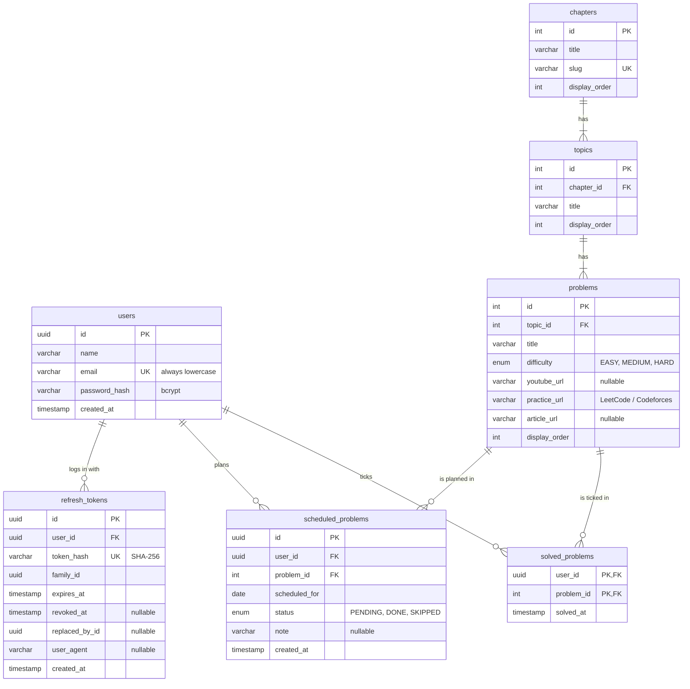

# Database Schema (LLD): DSA Sheet

PostgreSQL, managed with Prisma 7 (source of truth: [`prisma/schema.prisma`](../prisma/schema.prisma), SQL:
[`prisma/migrations`](../prisma/migrations)). Table names are plural `snake_case`; code uses `camelCase`.

Overview and architecture: [system-design.md](system-design.md).

## Tables at a glance

The assignment asks for Users, Topics, Problems and User Progress. They map to these tables:

| Assignment        | Table(s)                                | What one row means                                                  |
| ----------------- | --------------------------------------- | ------------------------------------------------------------------- |
| **Users**         | `users`                                 | One student                                                         |
| **Topics**        | `chapters` → `topics`                   | A chapter ("Arrays"), and a topic in it ("Two Pointers")            |
| **Problems**      | `problems`                              | One problem, with difficulty and learning links                     |
| **User Progress** | `solved_problems`, `scheduled_problems` | "This user solved this problem" / "…plans to solve it on this date" |
| (sessions)        | `refresh_tokens`                        | One login on one device                                             |

The **sheet** (chapters, topics, problems) is the same for every student. **Progress** is stored per student in two
link tables. Nothing about a student is copied into the sheet tables.

## Relationships



| Relationship                          | Type         | On delete                                               |
| ------------------------------------- | ------------ | ------------------------------------------------------- |
| chapter → topics                      | one-to-many  | blocked while the chapter still has topics              |
| topic → problems                      | one-to-many  | blocked while the topic still has problems              |
| user ↔ problem (`solved_problems`)    | many-to-many | deleting a user or a problem deletes its rows (cascade) |
| user ↔ problem (`scheduled_problems`) | many-to-many | cascade, as above                                       |
| user → refresh_tokens                 | one-to-many  | cascade                                                 |

## Tables

### `users`

| Column          | Type           | Rules                                                                                                                      |
| --------------- | -------------- | -------------------------------------------------------------------------------------------------------------------------- |
| `id`            | `uuid`         | Primary key. UUIDs can't be guessed or counted.                                                                            |
| `name`          | `varchar(100)` |                                                                                                                            |
| `email`         | `varchar(255)` | **Unique.** A `CHECK (email = lower(email))` constraint keeps it lowercase, so `A@x.com` and `a@x.com` can't both sign up. |
| `password_hash` | `varchar(255)` | bcrypt hash (cost 12). The password itself is never stored.                                                                |
| `created_at`    | `timestamp`    | default `now()`                                                                                                            |

### `chapters`

| Column          | Type           | Rules                          |
| --------------- | -------------- | ------------------------------ |
| `id`            | `serial int`   | Primary key                    |
| `title`         | `varchar(100)` | "Arrays"                       |
| `slug`          | `varchar(100)` | **Unique.** "arrays", for URLs |
| `display_order` | `int`          | Order on screen                |

### `topics`

| Column          | Type           | Rules                                        |
| --------------- | -------------- | -------------------------------------------- |
| `id`            | `serial int`   | Primary key                                  |
| `chapter_id`    | `int`          | → `chapters.id`                              |
| `title`         | `varchar(100)` | **Unique per chapter** `(chapter_id, title)` |
| `display_order` | `int`          |                                              |

### `problems`

| Column          | Type                 | Rules                                                           |
| --------------- | -------------------- | --------------------------------------------------------------- |
| `id`            | `serial int`         | Primary key                                                     |
| `topic_id`      | `int`                | → `topics.id`                                                   |
| `title`         | `varchar(200)`       | **Unique per topic** `(topic_id, title)`                        |
| `difficulty`    | enum `difficulty`    | `EASY` / `MEDIUM` / `HARD`. An enum, so a typo can't be stored. |
| `youtube_url`   | `varchar(500)`, null | Video explanation                                               |
| `practice_url`  | `varchar(500)`, null | LeetCode / Codeforces                                           |
| `article_url`   | `varchar(500)`, null | Theory reference                                                |
| `display_order` | `int`                |                                                                 |

### `solved_problems` (progress: the checkbox)

| Column       | Type        | Rules                                   |
| ------------ | ----------- | --------------------------------------- |
| `user_id`    | `uuid`      | → `users.id`, cascade                   |
| `problem_id` | `int`       | → `problems.id`, cascade                |
| `solved_at`  | `timestamp` | When it was first ticked                |
|              |             | **Primary key `(user_id, problem_id)`** |

A row exists = the problem is ticked. Unticking deletes the row. The composite primary key makes a duplicate tick
impossible, even if two requests arrive at the same moment.

### `scheduled_problems` (progress: the calendar)

| Column          | Type                   | Rules                                                                  |
| --------------- | ---------------------- | ---------------------------------------------------------------------- |
| `id`            | `uuid`                 | Primary key (used in the URL to move/update/delete one item)           |
| `user_id`       | `uuid`                 | → `users.id`, cascade                                                  |
| `problem_id`    | `int`                  | → `problems.id`, cascade                                               |
| `scheduled_for` | `date`                 | Date only: no time, so no time-zone bugs                               |
| `status`        | enum `schedule_status` | `PENDING` (default) / `DONE` / `SKIPPED`                               |
| `note`          | `varchar(500)`, null   |                                                                        |
| `created_at`    | `timestamp`            |                                                                        |
|                 |                        | **Unique `(user_id, problem_id)`**: a problem is on one date at a time |

"Missed" isn't stored: it's a `PENDING` item whose date has passed, worked out when reading. So it can never be out of date.

### `refresh_tokens` (sessions)

| Column           | Type                 | Rules                                                           |
| ---------------- | -------------------- | --------------------------------------------------------------- |
| `id`             | `uuid`               | Primary key                                                     |
| `user_id`        | `uuid`               | → `users.id`, cascade                                           |
| `token_hash`     | `varchar(64)`        | **Unique.** SHA-256 of the token; the raw token is never stored |
| `family_id`      | `uuid`               | Same for every token in one login chain (theft detection)       |
| `expires_at`     | `timestamp`          | now + 7 days                                                    |
| `revoked_at`     | `timestamp`, null    | Set when used, logged out or killed                             |
| `replaced_by_id` | `uuid`, null         | The token that replaced this one                                |
| `user_agent`     | `varchar(500)`, null | For debugging / a future "your devices" page                    |
| `created_at`     | `timestamp`          |                                                                 |

Old (expired or revoked) tokens are deleted when the server starts and once a day, so the table doesn't grow forever.

## Indexing strategy

Rule: **every query that runs on a user's request uses an index**, and every per-user index starts with `user_id`,
so a user's rows sit together in the index.

| Index                                                               | Used by                                                            |
| ------------------------------------------------------------------- | ------------------------------------------------------------------ |
| `users.email` (unique)                                              | Login: find the user by email                                      |
| `solved_problems` PK `(user_id, problem_id)`                        | Load a user's ticks (`WHERE user_id = ?`); tick/untick one problem |
| `solved_problems (problem_id)`                                      | Cascade delete when a problem is removed                           |
| `scheduled_problems (user_id, scheduled_for)`                       | Load a user's calendar, already sorted by date                     |
| `scheduled_problems (user_id, problem_id)` (unique)                 | "Is this problem already planned?" check + the one-date rule       |
| `scheduled_problems (problem_id)`                                   | Cascade delete when a problem is removed                           |
| `topics (chapter_id, display_order)`                                | Load a chapter's topics in order                                   |
| `problems (topic_id, display_order)`                                | Load a topic's problems in order                                   |
| `problems (difficulty)`                                             | Filtering / counting by difficulty                                 |
| `topics (chapter_id, title)`, `problems (topic_id, title)` (unique) | The seed script updates rows by title instead of adding duplicates |
| `chapters.slug` (unique)                                            | Chapter by slug                                                    |
| `refresh_tokens.token_hash` (unique)                                | Every refresh: find the token                                      |
| `refresh_tokens (user_id)`                                          | Log out on every device                                            |
| `refresh_tokens (family_id)`                                        | Theft detected: revoke the whole chain                             |

**Why not more indexes?** Each index slows writes a little and uses space. The sheet tables are tiny (~100 problems)
and cached in memory, so they barely need indexes. The progress tables get exactly the indexes their queries use.

## Size at 50,000 users (estimate)

| Table                | Rows (worst case)                     | Size (rough, with indexes) |
| -------------------- | ------------------------------------- | -------------------------- |
| `users`              | 50,000                                | ~15 MB                     |
| `solved_problems`    | 50,000 × 98 ≈ **4.9 M**               | ~0.5 GB                    |
| `scheduled_problems` | ≤ 4.9 M (one per user per problem)    | ~0.8 GB                    |
| `refresh_tokens`     | a few per user (old ones are cleaned) | ~50 MB                     |
| sheet tables         | ~130                                  | tiny                       |

About 1.5 GB in the worst case, where every student ticked and planned every problem. That fits one PostgreSQL server easily.

## Example queries

```sql
-- Resume progress on login: every problem this user has ticked (index: solved_problems PK)
SELECT problem_id FROM solved_problems WHERE user_id = $1;

-- Tick a problem (safe to repeat)
INSERT INTO solved_problems (user_id, problem_id) VALUES ($1, $2)
ON CONFLICT (user_id, problem_id) DO NOTHING;

-- The whole calendar, in date order (index: user_id, scheduled_for)
SELECT * FROM scheduled_problems WHERE user_id = $1 ORDER BY scheduled_for, created_at;

-- Calendar "Done" also ticks the problem: both in one transaction
BEGIN;
UPDATE scheduled_problems SET status = 'DONE' WHERE id = $1 AND user_id = $2;
INSERT INTO solved_problems (user_id, problem_id) VALUES ($2, $3) ON CONFLICT DO NOTHING;
COMMIT;
```

## The same design in MongoDB (for comparison)

The assignment mentions MERN. In MongoDB the same model would be:

- `users`, `chapters` (with topics and problems **embedded**, since the sheet is read as one document),
- `solvedProblems { userId, problemId, solvedAt }` with a **unique index** `{ userId: 1, problemId: 1 }`,
- `scheduledProblems { userId, problemId, scheduledFor, status, note }` with unique `{ userId: 1, problemId: 1 }`
  and index `{ userId: 1, scheduledFor: 1 }`,
- `refreshTokens` with unique `tokenHash` and a **TTL index** on `expiresAt`.

Progress stays in separate collections, not in an array inside the user document, so the user document doesn't keep growing.
PostgreSQL was chosen because foreign keys, cascades and transactions (Done → solved) come built in. See
[system-design.md → Trade-offs](system-design.md#7-trade-offs).
