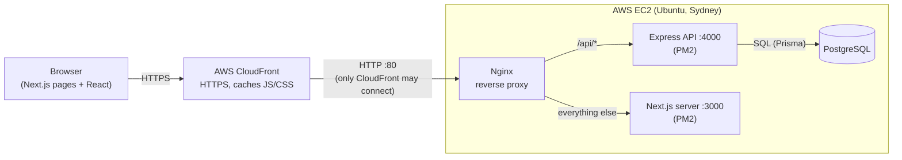
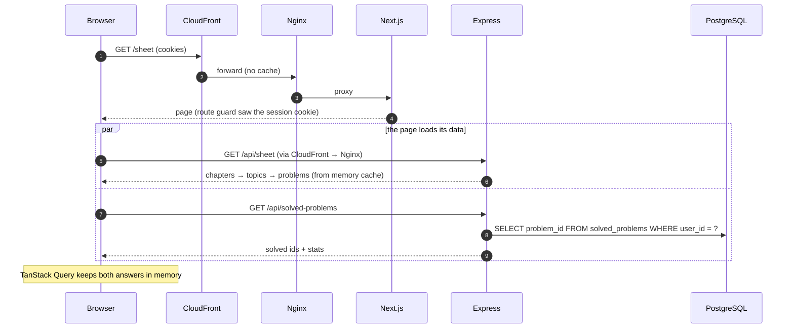
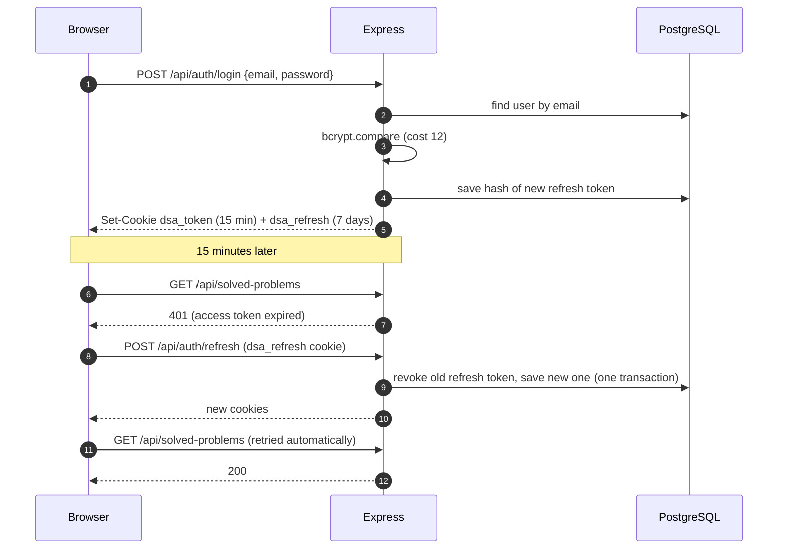
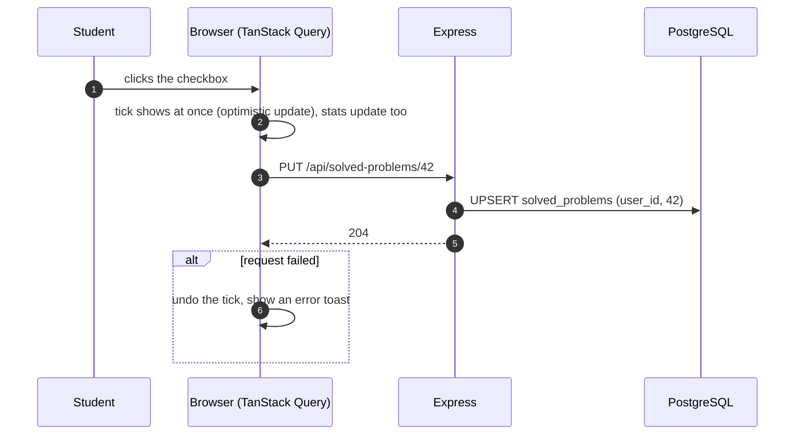
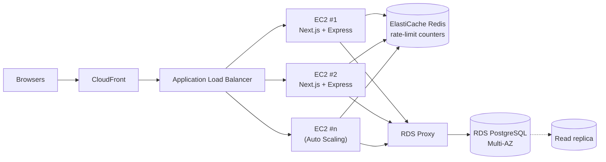

# System Design (HLD): DSA Sheet

A web app where students work through a DSA sheet (Chapters → Topics → Problems), tick off solved problems,
and plan problems on a calendar. Designed for **10,000–50,000 active users**.

- **Live:** https://d3n7j7klp7qcc3.cloudfront.net (demo login: `demo@dsasheet.dev` / `Demo@1234`)
- **Code:** [backend](https://github.com/KodeShaastra/Dsa-sheet-app-backend) ·
  [frontend](https://github.com/KodeShaastra/Dsa-sheet-app-frontend)
- **Database schema (LLD):** [database-schema.md](database-schema.md)

## 1. Tech stack

| Layer    | Choice                                                          | Why                                                           |
| -------- | --------------------------------------------------------------- | ------------------------------------------------------------- |
| Client   | **Next.js 16 (React 19)**, TypeScript, TanStack Query, Tailwind | React with routing, a server-side route guard and fast builds |
| Server   | **Node.js + Express 5**, TypeScript, Zod                        | Small, well-known, async errors handled without wrappers      |
| Database | **PostgreSQL** through Prisma 7                                 | The data is relational (see [trade-offs](#7-trade-offs))      |
| Hosting  | **AWS**: CloudFront → EC2 (Nginx, PM2)                          | Free HTTPS, one small server for the demo                     |

The assignment asks for MERN/MEAN. This keeps **Express, React and Node** and swaps MongoDB for PostgreSQL.
The reasons are in [section 7](#7-trade-offs).

## 2. Architecture: Client → Server → Database → Deployment

| Part               | Job                                                                                                              |
| ------------------ | ---------------------------------------------------------------------------------------------------------------- |
| **CloudFront**     | Gives the site HTTPS (needed for secure cookies). Caches the JS/CSS files at the edge. Never caches API answers. |
| **Security group** | The server's firewall. Port 80 accepts **only CloudFront** (AWS prefix list); SSH only from one IP.              |
| **Nginx**          | Sends `/api/*` to Express and everything else to Next.js. So the browser sees **one origin**: no CORS needed.    |
| **Next.js**        | Serves the pages. Its route guard sends logged-out users to `/login` before a page loads.                        |
| **Express**        | The API: login, sheet, progress, calendar. Checks every input with Zod.                                          |
| **PostgreSQL**     | Stores users, the sheet, progress and the calendar.                                                              |
| **PM2**            | Keeps both Node apps running, restarts them if they crash or use too much memory, starts them after a reboot.    |

## 3. Request flow

Example: a logged-in student opens the **Sheet** page.

Inside Express, every request goes through the same steps:
`helmet` (safe headers) → read JSON (max 100 kb) → read cookies → log → rate limit → **check login** →
**validate input (Zod)** → controller → service (logic + database) → one error handler (one error shape for everything).

## 4. Authentication

Email + password, with **two httpOnly cookies**. JavaScript in the page can never read the tokens.

| Token             | Cookie        | Lives  | What it is                                                                     |
| ----------------- | ------------- | ------ | ------------------------------------------------------------------------------ |
| **Access token**  | `dsa_token`   | 15 min | A signed JWT `{ sub: userId }`. Checked on every API call. No database lookup. |
| **Refresh token** | `dsa_refresh` | 7 days | A random 64-byte string. Only its **SHA-256 hash** is stored in the database.  |

Both cookies: `httpOnly`, `Secure` (HTTPS only), `SameSite=Lax`.

**Security details**

- **Passwords:** bcrypt, cost 12. Login errors never say whether the email or the password was wrong.
- **Rotation:** every refresh gives a new refresh token and revokes the old one.
- **Theft detection:** if an **already-used** refresh token comes back, someone may have copied it. The whole
  login chain (`familyId`) is revoked, and the user must log in again. (Two tabs refreshing in the same 30 seconds are allowed.)
- **Log out everywhere:** `POST /api/auth/logout-all` revokes every refresh token of the user.
- **Rate limits per IP:** login and signup 5/min, refresh 30/min, the whole API 300/min. The real visitor IP is taken
  from the proxy header (`trust proxy` = 2 hops: CloudFront → Nginx). Port 80 only accepts CloudFront, so the header can't be faked.
- **Frontend:** the route guard checks the 7-day cookie, so users stay logged in. On any 401, the app makes **one** shared
  refresh call (even if 5 requests failed at once), then retries. Only if that fails does it go to `/login`.

## 5. Data flow for progress tracking

### Ticking a problem

- **Saved at once:** every tick is one row in `solved_problems`. Nothing is kept only in the browser.
- **Resume where you left off:** on the next login, `GET /api/solved-problems` returns every ticked problem id plus
  stats (overall, by difficulty, by chapter). The sheet shows the same ticks and progress bars.
- **Safe to repeat:** `PUT` (tick) and `DELETE` (untick) give the same result if sent twice. A double click or a retry
  can't create a duplicate. The primary key `(user_id, problem_id)` also makes duplicates impossible.

### Calendar

- `GET /api/scheduled-problems` returns the user's **whole calendar in one request**. It stays small because a problem
  can be on only one date at a time (at most ~100 rows per user). The month view, week summary and "already planned"
  labels are all built from this one answer.
- Adding problems to a day: `POST` with a date and a list of problem ids. It's all-or-nothing: if any problem is already
  planned, nothing is added and the answer says which one (409).
- Dates in the past are refused (400). A missed problem (still pending on a past date) can be moved to today or marked done.
- **Done on the calendar = solved on the sheet:** `PATCH status: DONE` also ticks the problem, in **one transaction**, so both
  pages always agree.

## 6. Scalability

### How much load is 10,000–50,000 active users?

Rough numbers (estimates, not measurements):

| Measure                          | Estimate                                                                   |
| -------------------------------- | -------------------------------------------------------------------------- |
| Online at the busiest time       | ~10% of users → **1,000–5,000**                                            |
| API requests at the busiest time | each active user clicks every ~10 s → **100–500 requests/second**          |
| `solved_problems` rows           | 50,000 users × up to 98 problems → **≤ 5 million rows** (a few hundred MB) |
| `scheduled_problems` rows        | ≤ 1 row per user per problem → **≤ 5 million rows**                        |

This is a modest load for PostgreSQL when the queries use indexes, and they all do.

### What is already built in

| Technique                        | Effect                                                                                                                                                                      |
| -------------------------------- | --------------------------------------------------------------------------------------------------------------------------------------------------------------------------- |
| **Sheet cached in memory**       | The sheet is the same for everyone. It's loaded once, kept for 10 min, and the browser is told it may reuse it for 5 min. The most-read data costs almost no database work. |
| **Stats from the cache**         | Progress stats are counted from the cached sheet + one indexed query of the user's solved ids.                                                                              |
| **Stateless access tokens**      | Checking a JWT needs no database call, so any server can handle any request.                                                                                                |
| **Indexes on every query path**  | Every per-user query uses an index that starts with `user_id` (see [schema](database-schema.md#indexing-strategy)).                                                         |
| **One calendar request**         | The whole calendar comes in one request, not one per month.                                                                                                                 |
| **Optimistic UI + client cache** | TanStack Query keeps data in the browser and doesn't re-fetch it on every page change.                                                                                      |
| **CDN for static files**         | JS/CSS are cached by CloudFront at the edge; the server only serves pages and the API.                                                                                      |
| **Rate limits**                  | One noisy client can't slow everyone else down.                                                                                                                             |
| **PM2 memory limits**            | An app that uses too much memory is restarted automatically.                                                                                                                |

### Growing beyond one server

The demo runs on one small EC2 server. For the real 10k–50k users, the steps in order:

1. **Move the database to Amazon RDS** (Multi-AZ): automatic backups and failover, and the app servers become replaceable.
2. **Several app servers behind a load balancer**, with Auto Scaling. This works today because the API is stateless.
3. **Shared rate-limit counters in Redis.** Today the counters live in each server's memory; with many servers they must be shared.
4. **Connection pooling** (RDS Proxy or PgBouncer). Each Node process keeps a small pool; many servers × pools would otherwise use up PostgreSQL's connections.
5. **Read replicas** if reads ever become the bottleneck. Progress writes are tiny, so this is unlikely at this size.
6. **Monitoring:** CloudWatch alarms on CPU, memory, 5xx errors and database connections.

The in-memory sheet cache can stay per server: the sheet rarely changes, and a few minutes of delay after an edit is fine.

## 7. Trade-offs

| Decision                                 | Why                                                                                                                                                                                       | Cost                                                                                                                     |
| ---------------------------------------- | ----------------------------------------------------------------------------------------------------------------------------------------------------------------------------------------- | ------------------------------------------------------------------------------------------------------------------------ |
| **PostgreSQL instead of MongoDB**        | The data is relational: users ↔ problems in two link tables, a fixed hierarchy. Postgres gives foreign keys, unique keys (no duplicate ticks), cascades and transactions (Done → solved). | Not the "M" in MERN. Schema changes need migrations.                                                                     |
| **Cookies, not tokens in localStorage**  | httpOnly cookies can't be stolen by injected JavaScript (XSS).                                                                                                                            | Needs HTTPS (so CloudFront) and the same origin for page and API.                                                        |
| **Short JWT + refresh token**            | Fast checks (no DB) but sessions can still be ended: logout, theft detection, log out everywhere.                                                                                         | More code than a single long-lived JWT. A revoked session can live up to 15 more minutes until its access token expires. |
| **One origin (Nginx routes `/api`)**     | No CORS, no preflight requests, simpler cookies.                                                                                                                                          | Page and API must sit behind the same domain.                                                                            |
| **Whole calendar in one request**        | Simpler code, one cache, instant month switching.                                                                                                                                         | Only works because a problem is on one date at a time (small list).                                                      |
| **One date per problem**                 | Matches how students plan ("when will I do this?"), keeps the calendar small.                                                                                                             | Can't plan the same problem twice (e.g. for revision).                                                                   |
| **Sheet cached in each server's memory** | The most-read data needs no database or Redis.                                                                                                                                            | An edit to the sheet shows up after up to 10 min (+5 min browser cache).                                                 |
| **Optimistic ticks**                     | The checkbox feels instant.                                                                                                                                                               | The UI has to undo the change if the request fails.                                                                      |
| **One EC2 server for the demo**          | Cheap (fits the AWS free plan), easy to understand.                                                                                                                                       | No high availability. Fine for a demo; see "Growing beyond one server".                                                  |
| **Postgres on the same EC2**             | Free, no extra service.                                                                                                                                                                   | Backups and failover are manual; RDS fixes this.                                                                         |

## 8. API design (summary)

REST + JSON. Ids are strings, dates are `YYYY-MM-DD`. Every error has the same shape:
`{ "error": { "code", "message", "details": [] } }`.

| Method         | Path                                                                   | What it does                                             |
| -------------- | ---------------------------------------------------------------------- | -------------------------------------------------------- |
| POST           | `/api/auth/signup` · `/login` · `/refresh` · `/logout` · `/logout-all` | Accounts and sessions                                    |
| GET            | `/api/auth/me`                                                         | The logged-in user                                       |
| GET            | `/api/sheet`                                                           | Chapters → topics → problems (with links and difficulty) |
| GET            | `/api/solved-problems`                                                 | Solved problem ids + stats                               |
| PUT / DELETE   | `/api/solved-problems/:problemId`                                      | Tick / untick (safe to repeat)                           |
| GET            | `/api/scheduled-problems`                                              | The whole calendar                                       |
| POST           | `/api/scheduled-problems`                                              | Plan problems on a date                                  |
| PATCH / DELETE | `/api/scheduled-problems/:scheduledProblemId`                          | Move, mark done/skipped, add a note, remove              |

Full table with bodies and status codes: [backend README → API](../README.md#api).

## 9. Deployment

Details and commands: [deploy/DEPLOY.md](../deploy/DEPLOY.md).

- **One-time setup:** `deploy/setup-server.sh` installs Nginx, PostgreSQL, Node.js and PM2, creates the database and a
  `.env` with random secrets (never printed or committed), builds both apps and starts them.
- **Updates:** push to GitHub, then run `deploy/update.sh` on the server (pull, migrate, build, reload).
- **Logs** are rotated (10 MB per file, 5 kept), so the disk can't fill up.
